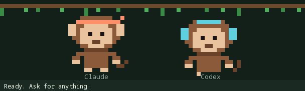
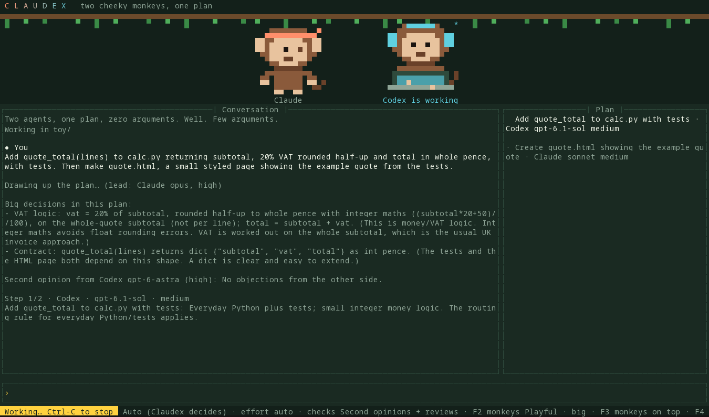
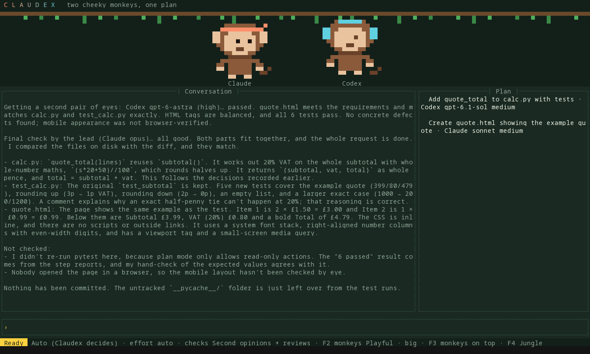
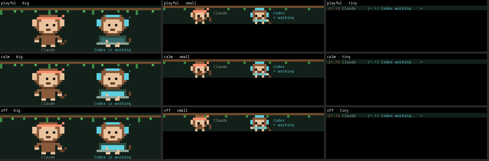
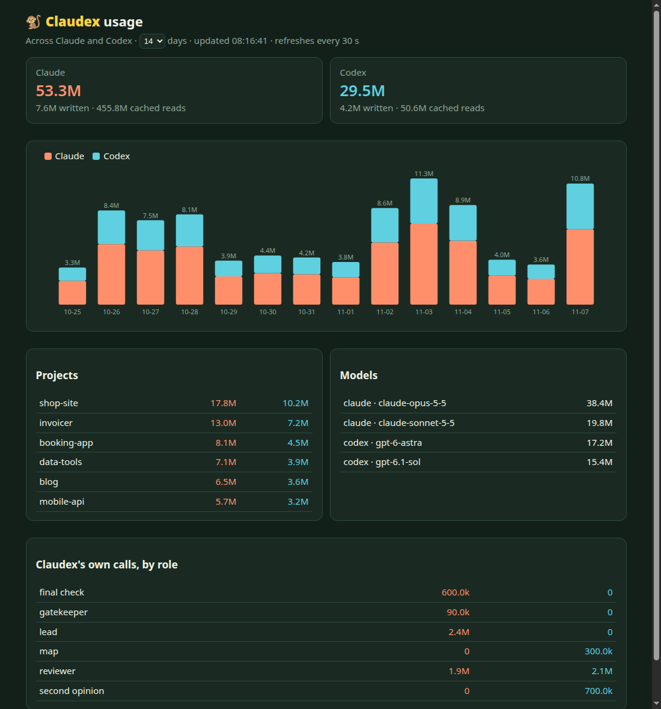

<div align="center">



# Claudex

**Two cheeky monkeys, one plan.**
A lead plans the job; **Claude Code** and **OpenAI Codex** each do the parts they're best at,
check each other's work, and share one memory. In your terminal, or inside Agents of Empires.

[](https://github.com/lewis-morris/claudex/actions/workflows/tests.yml)


**[📖 The how-to guide](docs/guide.md)**: install, your first job, and every command with screenshots.

</div>

---

> **Not an official product.** Claudex is an independent, open-source project. It isn't made by, endorsed by,
> or connected to Anthropic or OpenAI. It drives the official `claude` and `codex` command-line tools you
> already have, signed in with your own accounts. "Claude" and "Codex" are their owners' trademarks.

## Why

Claude is great at front ends and pictures-on-screens work. Codex is great at sums, logic and data. Most jobs
need both, and the best results come when someone *else* checks the work. Claudex is that team:

- **One lead plans.** It reads the codebase and splits your request into the fewest parts, picking agent,
  model and reasoning level for each from a rules table you control.
- **Big decisions get a second opinion** from the other side *before* any work starts: database schemas,
  money logic, new dependencies, contracts between parts. The lead answers every concern in writing.
- **Workers take turns**: one part at a time, each in its own real Claude Code or Codex session.
- **Every change is reviewed by the other agent** (with reviews on, the default). Problems go back to the same worker; if they keep failing,
  it steps up to a stronger model; then it stops and tells you what's still wrong. (If the other agent is at
  its usage limit, the same side checks instead, and Claudex says so in bold.)
- **One shared memory.** Everyone (lead, workers, reviewers) sees the same project map, past decisions,
  a journal of every job from every session, each worker's handover, and *both* `CLAUDE.md` and `AGENTS.md`.
- **Its own permission rules, with a gatekeeper.** Workers ask before acting; Claudex answers from one set
  of rules for both agents, a quick gatekeeper model handles the grey areas, and only the hard calls reach you.
  Or go **unrestricted** and nothing asks at all.
- **Usage limits handled.** If one agent runs out mid-job, the other finishes that part with a recap of what
  was done, and the check covers both agents' changes. If both are out, it stops and tells you when each
  resets (when the tool says). Send a job to one agent on purpose (`@codex …`) and it's never switched.

## What it looks like



<details>
<summary>…and when the job's done</summary>



</details>

The monkeys act out what's happening: both scratch their heads while the lead plans, the one working taps at
a little laptop while the other watches, a banana flies across when work goes to be checked, a thumbs-up or a
"!" comes back, and there's confetti when it's done. In between they wink, pull faces and side-eye each other.

**Not your thing?** Press **F2**. Three styles × three sizes:



`/anim calm tiny` gives you one quiet line of little faces: `(•‿•) Claude   (•‿•) Codex working…`

## Install

You need **Claude Code** and **Codex** installed and signed in, plus their ACP connectors:

```bash
npm install -g @anthropic-ai/claude-code @openai/codex \
               @agentclientprotocol/claude-agent-acp @agentclientprotocol/codex-acp
```

Then Claudex (Python 3.11+):

```bash
uv tool install git+https://github.com/lewis-morris/claudex     # or: pipx install git+https://…
claudex login      # signs in to whichever of Claude / Codex isn't signed in yet
claudex doctor     # checks logins, connectors and every model in the rules
```

Or run it straight from a checkout: `git clone https://github.com/lewis-morris/claudex && claudex/bin/claudex`
(that needs a Python 3.11+ that has `prompt_toolkit`: your system one, or point `CLAUDEX_PYTHON` at a virtualenv's
Python; it tells you how if it's missing).

## Use

```bash
cd your-project            # a git repo: Claudex snapshots files to see and check every change
claudex                    # full screen
claudex -p "add VAT to the quote total, with tests, then show it on the quote page"
claudex --dry-run -p "…"   # just show the plan and who'd do what
```

Type **`/`** for a menu of every command and every skill you have installed (Claude's marked **[C]**,
Codex's **[X]**). `/deployify ship it` runs that skill. Start a message with `@claude` or `@codex` to send it
to just one of them.

| Key | Does |
|---|---|
| **F2** | monkeys: playful / calm / off × big / small / tiny |
| **F3** | layout: monkeys on top / at the side / just the chat |
| **F4** | colours: Jungle, Sunset, Daylight |
| **PgUp / PgDn** | scroll |
| **Ctrl-C** | stop the current job (the chat stays open) |
| **Ctrl-D** or `/quit` | leave |

## Permissions: ask, auto, or unrestricted

| Mode | What happens |
|---|---|
| `ask` | every request comes to you |
| `auto` (default) | Claudex's rules decide: **deny** rules first, then **ask** (you), then **allow**. Anything not covered goes to the **gatekeeper** (Claude Sonnet, low effort), which allows, denies, or passes it to you. Nobody watching (scripts, the benchmark)? "Ask you" becomes "no" |
| `unrestricted` | the workers run in their most permissive modes and never ask. A red **UNRESTRICTED** warning sits in the status bar. Use it on throwaway branches or machines |

The default rules let workers read anything, edit inside the project, and run tests, builds, linters and
`git status/diff/log`. They ask you about `git push`, deploys, installs, `ssh`, deleting folders and the
internet, and refuse `sudo`, your `~/.ssh` and other secrets, force-pushes, `curl … | sh`, and edits outside
the project. A chained command (`ls && curl …`) never sneaks through on an allow rule: the gatekeeper looks at
it, and neither does anything with a variable or wildcard in it (`$HOME`, `*`). Every decision is logged with
who made it: `claudex permissions` shows the rules and the last 30.

**What it is and isn't.** In `auto`, everything the agents *ask* about goes through these rules. Each agent
still has a few things it does without asking (both read files; Claude also follows any allow-list in your own
Claude settings; Codex keeps its sandbox), so treat this as a strong filter, not a sandbox. Don't point
Claudex at code you don't trust, and keep `unrestricted` for throwaway branches.
Change them everywhere with `claudex rules --edit`, or just for one project with `claudex permissions --edit`.

```
$ claudex permissions
  …
  11-07T08:12 allow gatekeeper  claude run  cat >> calc.py <<'EOF' …   Appends triple() to calc.py, a normal edit…
  11-07T08:14 deny  rule        codex  edit /etc/hosts                  edit:@outside
```

## One setup for both agents

- **`claudex init`** sets a project up: one house-rules file both agents follow (`AGENTS.md`, with `CLAUDE.md`
  pointing at it, which Claude supports, so it works outside Claudex too), the memory folder, a project rules
  file, and a first project map. It shows you the changes first and never commits them.
- **`claudex shared`** shows what the two agents share and what they don't: house rules, skills (Claude only /
  Codex only / both), and connectors (MCP servers). `--link-skills` makes every skill available to both.
- **`claudex memory`** lists everything Claudex remembers about the project, with the map, decisions and recent jobs.

## Usage across both agents

`claudex usage` draws a coloured chart of tokens by day, project, model and Claudex role, read from both agents'
own logs plus Claudex's one-shot calls. It also shows **who did the work, and why**: how many parts each agent
and model finished in Claudex jobs, how long they took, how often the check sent work back, and the lead's
most common reasons for choosing them; plus the checks run and who answered permission questions. `claudex usage --web` opens a live page (add `--lan` to see it on your
phone); `--json` gives raw numbers. In the chat: `/usage`, `/usage web`.



<sub>Example data. Neither tool reports how much of your plan's allowance is left, so this shows tokens.</sub>

## Does it actually help? `claudex bench`

`claudex bench` races **Claude alone**, **Codex alone** and **Claudex** on the same small projects, each run
unattended in a fresh folder:

- **Hidden tests** it never saw decide the main score (% passing).
- **Two blind reviewers** (Claude Opus and Codex Astra) mark an anonymous copy out of 10.
- **Time** and **tokens** (from both agents' logs for that folder) show the cost.

**First results** (7 Nov 2026, one run each, so treat as a first look, not a verdict):

| Task | Contender | Hidden tests | Blind review /10 | Minutes | Tokens |
|---|---|---|---|---|---|
| Clean a messy customer CSV | Claude | 100% | 8.5 | 1.0 | 68k |
| | Codex | 100% | **9.0** | 1.0 | **22k** |
| | Claudex | 100% | 8.0 | 2.5 | 172k |
| VAT quote + quote page | Claude | 100% | 9.0 | 0.8 | 64k |
| | Codex | 100% | **9.5** | 0.9 | **22k** |
| | Claudex | 100% | 9.0 | 3.4 | 318k |

On small, one-sitting jobs like these, a single agent was just as correct, faster and far cheaper: Claudex's
planning, second opinions and cross-checks cost 3–4× the time and 8–14× Codex's tokens without improving the
result. That's worth knowing. Claudex is built for bigger, multi-part jobs where one agent's blind spots
matter, and those aren't benchmarked yet. For small jobs, send them straight to one agent (`@codex …`) or use
`--checks off`. Add harder tasks of your own and run `--runs 3` to see where your work falls.

It writes `report.md`, `report.html` and `results.json` to `~/.local/share/claudex/bench/`. Tasks live in
[`claudex/bench_tasks/`](claudex/bench_tasks): a brief, a starter project, and hidden tests. Add your own.
`--runs 2` or more gives fairer results (models vary from run to run).

<details>
<summary><b>All commands and options</b></summary>

```
claudex                      chat in this folder (full screen; --plain for a simple line chat)
claudex -p "message"         run one message, then exit (exit code 1 if it failed or a check found problems)
claudex --acp                run as an ACP agent (Agents of Empires, Zed, …)
claudex login [claude|codex] sign in to whichever isn't signed in (--device for a code, --again to redo)
claudex doctor [--live]      logins, versions, connectors, every model in the rules (--live: ping each model)
claudex models [--edit] [--global]   who does what, and where it comes from (models.md)
claudex rules [--edit]       the full rules file (--edit makes your own copy and opens it)
claudex log [-n N]           recent steps in this project
claudex update               update Claude, Codex and both connectors, then run doctor
claudex init                 one house-rules file for both agents, memory, project rules, first map
claudex shared [--link-skills]   what both agents share (house rules, skills, connectors)
claudex memory [--files]     this project's Claudex memory
claudex permissions [--edit] the rules in force and every recent decision
claudex usage [--web --lan --json --days N --project DIR]   tokens across both agents
claudex bench [--tasks … --arms … --runs N --no-judge]      race Claude, Codex and Claudex
claudex demo                 a pretend job, to preview the look

  --route auto|claude|codex           who does the work (default auto)
  --mode ask|auto|unrestricted        who approves what workers do (default auto)
  --unattended                        nobody's watching: anything that would ask you is refused
  --effort auto|low|medium|high|xhigh force one reasoning level for every step
  --checks full|reviews|off           second opinions + reviews / reviews only / none
  --lead-model M  --lead-effort E     change the lead for this run
  --models FILE                       use this models.md for this session
  --rules FILE   --dry-run   --cwd DIR   --plain
```

In the chat: `/auto /claude /codex`, `/effort …`, `/mode …`, `/checks …`, `/anim …`, `/dry`, `/status`,
`/init`, `/models`, `/shared`, `/memory`, `/permissions`, `/usage` (`/usage web`), `/rules`, `/doctor`, `/log`, `/help`, `/quit`.

</details>

## How a job runs


## Who does what

`claudex models` shows who does what and where it comes from. To change it, `claudex models --edit` writes a
plain **`models.md`** you can edit: a who-does-what table, the lead / default / checker / gatekeeper models, and
any notes you want the lead to follow ("money work always goes to Codex Astra"). Per project
(`.claudex/models.md`) or for every project (`--global`); `claudex --models FILE` for one session.
[More in the guide.](docs/guide.md#4-who-does-what-modelsmd)

The defaults (from [`claudex/rules.toml`](claudex/rules.toml)):

| Job | Agent | Model | Reasoning |
|---|---|---|---|
| Lead: planning, splitting, final check | Claude | Opus 5.5 | high |
| Checking the other side's work, second opinions | Claude / Codex | Opus 5.5 / GPT-6 Astra | high |
| Small fixes, CSS tweaks, config, simple scripts | Codex | GPT-6.1 Sol | low |
| Everyday Python, Flask, React, Shopify, APIs, tests | Codex | GPT-6.1 Sol | medium |
| Multi-file features, migrations, integrations, speed | Codex | GPT-6.1 Sol | high |
| Hard debugging, algorithms, PostgreSQL, heavy logic | Codex | GPT-6 Astra | high |
| Persistent bugs, concurrency, major failures | Codex | GPT-6 Astra | xhigh |
| React, MUI, HTML/CSS, docs, front end | Claude | Sonnet 5.5 | medium |
| Complex UI, front-end architecture, UX | Claude | Sonnet 5.5 | high |
| Anything needing your signed-in browser | Claude + Chrome | Sonnet 5.5 | medium |
| Architecture, big refactors, auth | Claude | Opus 5.5 | high / xhigh |

When a review keeps failing, the worker steps up a ladder (Sol low → medium → high → Astra high → xhigh;
Sonnet medium → high → Opus medium → high → xhigh). Never Max.

## The shared memory

Everything lives in `.claudex/` at the top of your repo (kept out of git automatically):

| File | What |
|---|---|
| `project/map.md` | how the project is laid out, refreshed after each completed job that changed files |
| `project/decisions.md` | big decisions, second opinions, and the lead's answer to each concern |
| `project/journal.md` | every job from every session: who did what, handovers, what the checks found |
| `sessions/<id>/notes.md` | this session's requests, handovers and reviews (long handovers saved whole) |
| `sessions/<id>/steps.jsonl` | agent, model, reasoning, time and verdict for every step |
| `permissions.jsonl` | every permission decision: what, who decided (rule, gatekeeper, you), why |
| `rules.toml` | this project's own rules, layered over yours (made by `claudex init`) |

Every role gets the same memory, plus your project's `CLAUDE.md` **and** `AGENTS.md` (in full; a file over
40,000 characters comes with an instruction to read the rest), so both agents follow one set of house rules. A test (`test_everyone_shares_one_memory`) proves it across two sessions.

## Browser

Steps that need your signed-in browser go to Claude with **Claude in Chrome** switched on. Only one agent uses
Chrome at a time, across every Claudex session on the machine. Codex can't use your signed-in Chrome, so
browser steps never go to it.

## Agents of Empires

Claudex speaks ACP, so it plugs into [Agents of Empires](https://github.com/agent-of-empires/agent-of-empires)
as a custom agent. Add to `~/.config/agent-of-empires/config.toml`:

```toml
[session.custom_agents]
claudex = "claudex"

[session.agent_acp_cmd]
claudex = "claudex --acp"
```

Pick **claudex** for a new session: you get Routing, Effort, Mode and Checks pickers, and the same `/` menu.

New sessions always run the Claudex you have now. A session that was already open when Claudex changed says
so before its next job, and `claudex doctor` lists any such sessions with the command to restart each
(`aoe acp stop <id>`; it comes back on your next message). `claudex update` updates Claudex itself as well as
Claude, Codex and the connectors.

## Safety

- **Reviewers, the lead and the second opinion are read-only**, with your MCP servers, hooks and Chrome
  switched off.
- **Snapshots never touch your git index**: Claudex compares files using a private temporary index.
- **It never commits or pushes** unless you ask a worker to.
- **If a check can't run** (signed out, timed out), the job stops rather than pretending it passed. If it
  can't run because of a usage limit, the other side's strongest model checks instead, flagged as not
  independent.
- **Permissions are Claudex's own** (see above): in `auto`, workers ask and Claudex's rules and gatekeeper
  answer, logged. Codex also keeps its own sandbox underneath. `unrestricted` turns all of that off, by design.

## Development

```bash
uv run --no-project --with pytest --with prompt_toolkit python -m pytest -q    # 71 tests, no models called
```

The tests use stand-in agents, so they're free and fast. Design notes and the review history are in
[`docs/claudex-design.md`](docs/claudex-design.md).

## Licence

MIT. See [LICENSE](LICENSE).
