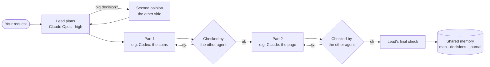

<div align="center">


# Claudex

**Two cheeky monkeys, one plan.**
A lead plans the job; **Claude Code** and **OpenAI Codex** each do the parts they're best at,
check each other's work, and share one memory. In your terminal, or inside Agents of Empires.

[](https://github.com/lewis-morris/claudex/actions/workflows/tests.yml)


</div>

---

> **Not an official product.** Claudex is an independent, open-source project. It isn't made by, endorsed by,
> or connected to Anthropic or OpenAI. It drives the official `claude` and `codex` command-line tools you
> already have, signed in with your own accounts. "Claude" and "Codex" are their owners' trademarks.

## Why

Claude is great at front ends and pictures-on-screens work. Codex is great at sums, logic and data. Most jobs
need both, and the best results come when someone *else* checks the work. Claudex is that team:

- **One lead plans.** It reads the codebase and splits your request into the fewest parts, picking agent,
  model and reasoning level for each from a rules table you control.
- **Big decisions get a second opinion** from the other side *before* any work starts: database schemas,
  money logic, new dependencies, contracts between parts. The lead answers every concern in writing.
- **Workers take turns**: one part at a time, each in its own real Claude Code or Codex session.
- **Every change is reviewed by the other agent.** Problems go back to the same worker; if they keep failing,
  it steps up to a stronger model; then it stops and tells you what's still wrong. (If the other agent is at
  its usage limit, the same side checks instead, and Claudex says so in bold.)
- **One shared memory.** Everyone (lead, workers, reviewers) sees the same project map, past decisions,
  a journal of every job from every session, each worker's handover, and *both* `CLAUDE.md` and `AGENTS.md`.
- **Usage limits handled.** If one agent runs out mid-job, the other finishes that part with a recap of what
  was done, and the check covers both agents' changes. If both are out, it stops and tells you when each
  resets (when the tool says). Send a job to one agent on purpose (`@codex …`) and it's never switched.

## What it looks like


<details>
<summary>…and when the job's done</summary>


</details>

The monkeys act out what's happening: both scratch their heads while the lead plans, the one working taps at
a little laptop while the other watches, a banana flies across when work goes to be checked, a thumbs-up or a
"!" comes back, and there's confetti when it's done. In between they wink, pull faces and side-eye each other.

**Not your thing?** Press **F2**. Three styles × three sizes:


`/anim calm tiny` gives you one quiet line of little faces: `(•‿•) Claude   (•‿•) Codex working…`

## Install

You need **Claude Code** and **Codex** installed and signed in, plus their ACP connectors:

```bash
npm install -g @anthropic-ai/claude-code @openai/codex \
               @agentclientprotocol/claude-agent-acp @agentclientprotocol/codex-acp
```

Then Claudex (Python 3.11+):

```bash
uv tool install git+https://github.com/lewis-morris/claudex     # or: pipx install git+https://…
claudex login      # signs in to whichever of Claude / Codex isn't signed in yet
claudex doctor     # checks logins, connectors and every model in the rules
```

Or run it straight from a checkout: `git clone https://github.com/lewis-morris/claudex && claudex/bin/claudex`
(that needs Python 3.11+ with `prompt_toolkit`; it tells you how to get it if it's missing).

## Use

```bash
cd your-project            # a git repo: Claudex snapshots files to see and check every change
claudex                    # full screen
claudex -p "add VAT to the quote total, with tests, then show it on the quote page"
claudex --dry-run -p "…"   # just show the plan and who'd do what
```

Type **`/`** for a menu of every command and every skill you have installed (Claude's marked **[C]**,
Codex's **[X]**). `/deployify ship it` runs that skill. Start a message with `@claude` or `@codex` to send it
to just one of them.

| Key | Does |
|---|---|
| **F2** | monkeys: playful / calm / off × big / small / tiny |
| **F3** | layout: monkeys on top / at the side / just the chat |
| **F4** | colours: Jungle, Sunset, Daylight |
| **PgUp / PgDn** | scroll |
| **Ctrl-C** | stop the current job (the chat stays open) |
| **Ctrl-D** or `/quit` | leave |

<details>
<summary><b>All commands and options</b></summary>

```
claudex                      chat in this folder (full screen; --plain for a simple line chat)
claudex -p "message"         run one message, then exit (exit code 1 if it failed or a check found problems)
claudex --acp                run as an ACP agent (Agents of Empires, Zed, …)
claudex login [claude|codex] sign in to whichever isn't signed in (--device for a code, --again to redo)
claudex doctor [--live]      logins, versions, connectors, every model in the rules (--live: ping each model)
claudex rules [--edit]       who does what (--edit makes your own copy and opens it)
claudex log [-n N]           recent steps in this project
claudex update               update Claude, Codex and both connectors, then run doctor
claudex demo                 a pretend job, to preview the look

  --route auto|claude|codex           who does the work (default auto)
  --mode default|acceptEdits|auto|bypassPermissions   what workers may do without asking (default auto)
  --effort auto|low|medium|high|xhigh force one reasoning level for every step
  --checks full|reviews|off           second opinions + reviews / reviews only / none
  --lead-model M  --lead-effort E     change the lead for this run
  --rules FILE   --dry-run   --cwd DIR   --plain
```

In the chat: `/auto /claude /codex`, `/effort …`, `/mode …`, `/checks …`, `/anim …`, `/dry`, `/status`,
`/rules`, `/doctor`, `/log`, `/memory`, `/help`, `/quit`.

</details>

## How a job runs



## Who does what

The defaults (in [`claudex/rules.toml`](claudex/rules.toml), re-read on every message; `claudex rules --edit`
to change them):

| Job | Agent | Model | Reasoning |
|---|---|---|---|
| Lead: planning, splitting, final check | Claude | Opus 5.5 | high |
| Checking the other side's work, second opinions | Claude / Codex | Opus 5.5 / GPT-6 Astra | high |
| Small fixes, CSS tweaks, config, simple scripts | Codex | GPT-6.1 Sol | low |
| Everyday Python, Flask, React, Shopify, APIs, tests | Codex | GPT-6.1 Sol | medium |
| Multi-file features, migrations, integrations, speed | Codex | GPT-6.1 Sol | high |
| Hard debugging, algorithms, PostgreSQL, heavy logic | Codex | GPT-6 Astra | high |
| Persistent bugs, concurrency, major failures | Codex | GPT-6 Astra | xhigh |
| React, MUI, HTML/CSS, docs, front end | Claude | Sonnet 5.5 | medium |
| Complex UI, front-end architecture, UX | Claude | Sonnet 5.5 | high |
| Anything needing your signed-in browser | Claude + Chrome | Sonnet 5.5 | medium |
| Architecture, big refactors, auth | Claude | Opus 5.5 | high / xhigh |

When a review keeps failing, the worker steps up a ladder (Sol low → medium → high → Astra high → xhigh;
Sonnet medium → high → Opus medium → high → xhigh). Never Max.

## The shared memory

Everything lives in `.claudex/` at the top of your repo (kept out of git automatically):

| File | What |
|---|---|
| `project/map.md` | how the project is laid out, refreshed after each job that changed files |
| `project/decisions.md` | big decisions, second opinions, and the lead's answer to each concern |
| `project/journal.md` | every job from every session: who did what, handovers, what the checks found |
| `sessions/<id>/notes.md` | this session's requests, handovers and reviews (long handovers saved whole) |
| `sessions/<id>/steps.jsonl` | agent, model, reasoning, time and verdict for every step |

Every role gets the same memory, plus your project's `CLAUDE.md` **and** `AGENTS.md` (in full; a file over
40,000 characters comes with an instruction to read the rest), so both agents follow one set of house rules. A test (`test_everyone_shares_one_memory`) proves it across two sessions.

## Browser

Steps that need your signed-in browser go to Claude with **Claude in Chrome** switched on. Only one agent uses
Chrome at a time, across every Claudex session on the machine. Codex can't use your signed-in Chrome, so
browser steps never go to it.

## Agents of Empires

Claudex speaks ACP, so it plugs into [Agents of Empires](https://github.com/agent-of-empires/agent-of-empires)
as a custom agent. Add to `~/.config/agent-of-empires/config.toml`:

```toml
[session.custom_agents]
claudex = "claudex"

[session.agent_acp_cmd]
claudex = "claudex --acp"
```

Pick **claudex** for a new session: you get Routing, Effort, Mode and Checks pickers, and the same `/` menu.

## Safety

- **Reviewers, the lead and the second opinion are read-only**, with your MCP servers, hooks and Chrome
  switched off.
- **Snapshots never touch your git index**: Claudex compares files using a private temporary index.
- **It never commits or pushes** unless you ask a worker to.
- **If a check can't run** (signed out, timed out), the job stops rather than pretending it passed. If it
  can't run because of a usage limit, the other side's strongest model checks instead, flagged as not
  independent.
- Workers run with the permission mode you choose (`--mode`); the default `auto` uses each agent's own
  safety checks.

## Development

```bash
uv run --no-project --with pytest --with prompt_toolkit python -m pytest -q    # 71 tests, no models called
```

The tests use stand-in agents, so they're free and fast. Design notes and the review history are in
[`docs/claudex-design.md`](docs/claudex-design.md).

## Licence

MIT. See [LICENSE](LICENSE).
