# Claudex: the how-to guide

A walk-through from install to your first job, then every command with what it looks like. Pictures are real
output (from a small demo project called `shop`; your folders will differ).

- [1. Install and sign in](#1-install-and-sign-in)
- [2. Set a project up](#2-set-a-project-up)
- [3. Run a job](#3-run-a-job)
- [4. Who does what: `models.md`](#4-who-does-what-modelsmd)
- [5. Permissions](#5-permissions)
- [6. What the agents share](#6-what-the-agents-share)
- [7. Memory](#7-memory)
- [8. Usage](#8-usage)
- [9. Is it worth it? The benchmark](#9-is-it-worth-it-the-benchmark)
- [10. Agents of Empires](#10-agents-of-empires)
- [Everyday recipes](#everyday-recipes)
- [Troubleshooting](#troubleshooting)

---

## 1. Install and sign in

You need Claude Code and Codex (and their ACP connectors), then Claudex:

```bash
npm install -g @anthropic-ai/claude-code @openai/codex \
               @agentclientprotocol/claude-agent-acp @agentclientprotocol/codex-acp
uv tool install git+https://github.com/lewis-morris/claudex
```

**Sign in** to both. `claudex login` only opens the sign-in for whichever one needs it:

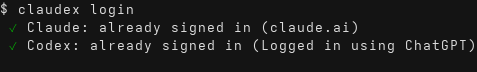

**Check everything** with `claudex doctor`: logins, versions, the two connectors, and every model the rules
mention. Anything wrong gets a red cross and the command that fixes it. `claudex doctor --live` also sends a
tiny message to each model to prove it answers.

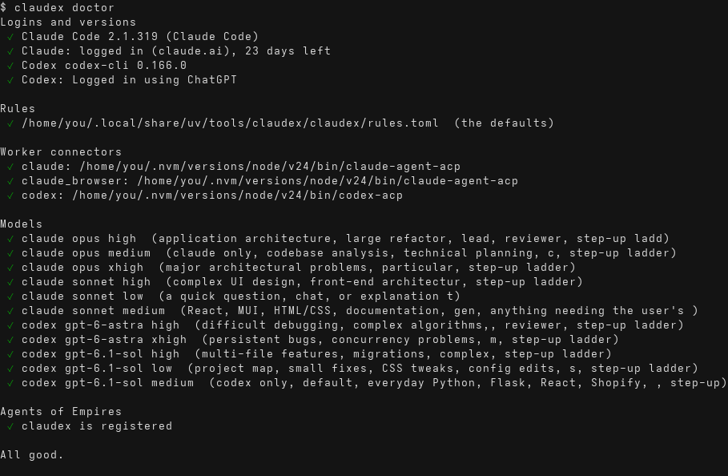

Keep it current with `claudex update`: it updates Claudex itself, Claude, Codex and both connectors, then
runs `doctor`.

## 2. Set a project up

In a git project, run `claudex init`. It:

- makes **one house-rules file** both agents follow: `AGENTS.md`, with `CLAUDE.md` pointing at it (Claude
  supports that), merging whatever you already had (your old file is kept as a `.bak`);
- creates the **memory folder** `.claudex/` and keeps it out of git;
- adds an empty **project rules** file for this project's own permissions or routing;
- asks a quick model for a first **project map** (skip with `--no-map`).

It shows the changes first, and never commits them.

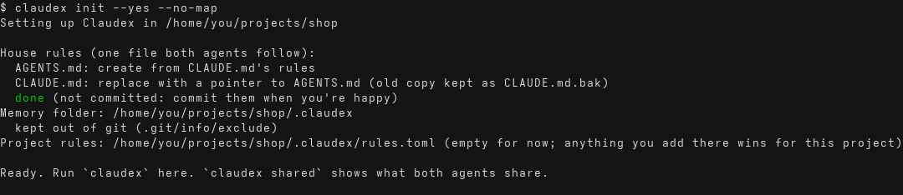

You don't *have* to run `init`: Claudex sets up its memory on the first job anyway. `init` is for when you
want one house-rules file that also works when you use Claude or Codex on their own.

## 3. Run a job

```bash
claudex                     # the full screen, with the monkeys
claudex -p "add VAT to the quote total, with tests, then show it on the quote page"   # one job, then exit
claudex --dry-run -p "…"    # just show the plan: who'd do what, nothing changes
```

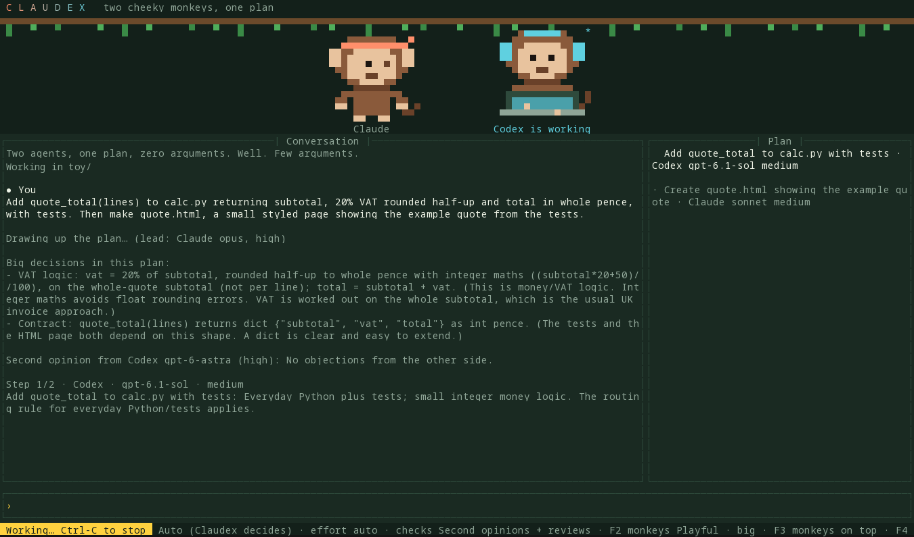

What happens, in order:

1. **The lead plans** (Claude Opus, high). It reads the project, splits the job into the fewest parts and
   picks who does each part, on which model and reasoning level.
2. **Big decisions get a second opinion** from the other side before anything is touched.
3. **One worker at a time** does each part, in a real Claude Code or Codex session.
4. **The other agent checks each change.** Problems go back to the same worker, then a stronger model,
   then it stops and tells you.
5. **The lead checks it all fits**, and the project map and journal are updated.

In the full screen:

| Key | Does |
|---|---|
| `/` | menu of commands: keep typing to narrow it, Tab or arrows to pick |
| `$` | menu of your skills (`$deployify ship it`) |
| `/resume` | pick an earlier conversation here with ↑ ↓ and Enter: its screen and plan come back, and Claude and Codex reload their own conversations, so they remember everything (`claudex --resume`, or `claudex -c` for the latest) |
| **Tab** or **→** | complete the highlighted command or skill (`/resu` + Tab → `/resume`; use → where the terminal keeps Tab, like Dolphin's panel); a clear abbreviation like `/stat` works on its own |
| `@claude …` / `@codex …` | send just that message to one agent |
| **F2** | monkeys: playful / calm / off × big / small / tiny (or `/anim calm small`) |
| **F3** | layout: monkeys on top / at the side / just the chat |
| **F4** | colours: Jungle, Sunset, Daylight |
| **Y / A / N** | answer a permission question: yes / yes and don't ask again / no (a yellow "Your answer needed" box shows it) |
| **Ctrl-C** | clear what you typed, or stop the current job; press it twice to quit |
| **PgUp / PgDn** | scroll |
| **Ctrl-D** / `/quit` | leave |

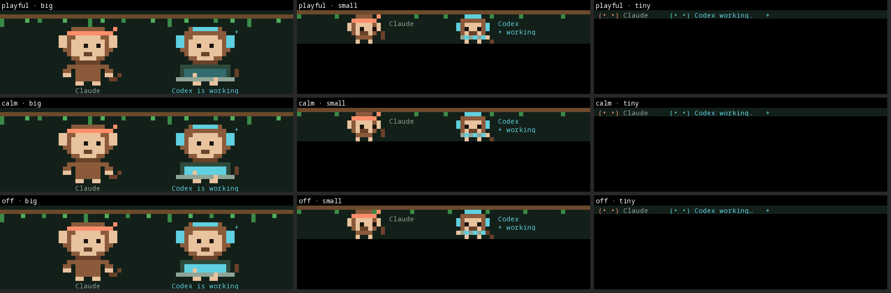

Skills you've installed for Claude (`~/.claude/skills`) or Codex (`~/.codex/skills`) are in the `/` menu too:
`$deployify ship the portal` runs that skill on the agent that has it.

## 4. Who does what: `models.md`

`claudex models` shows who does what right now, and where that comes from:

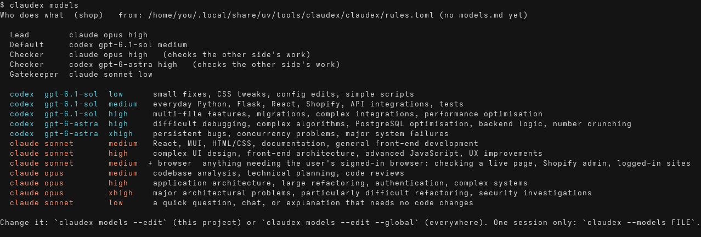

To change it, run `claudex models --edit`. It makes `.claudex/models.md` in this project from what's in
force now, and opens it. Add `--global` to change it for every project (`~/.config/claudex/models.md`).
It's plain Markdown:

```markdown
# Who does what

| When | Agent | Model | Reasoning | Browser |
|---|---|---|---|---|
| anything with money, VAT or invoices | codex | gpt-6-astra | high | |
| the shop's pages and emails | claude | sonnet | high | yes |
| everything else in Python | codex | gpt-6.1-sol | medium | |

Lead: claude opus high
Default: codex gpt-6.1-sol medium
Claude reviewer: opus high
Codex reviewer: gpt-6-astra high
Gatekeeper: claude sonnet low

## Notes for the lead

- Database migrations always get a second opinion, even small ones.
- Never touch the payments module without asking me.
```

- The **table** replaces the who-does-what rules.
- The **settings** lines change the lead, the default worker, the two checkers and the gatekeeper.
- **Anything else you write** goes to the lead as your guidance, word for word. That's the place for
  "always do X" or "never let Y near Z".
- `<!-- comments -->` are for people and are ignored.

The project's `models.md` beats your global one. For a single session, `claudex --models other.md` uses that
file instead. In the chat, `/models` shows what's in force.

## 5. Permissions

Workers ask before they act. Who answers depends on the mode (`--mode`, or `/mode` in the chat):

| Mode | Who answers |
|---|---|
| `ask` | you, every time |
| `auto` | Claudex's rules: **deny** first, then **ask** (you), then **allow**. Anything the rules don't cover goes to the **gatekeeper** (a quick model), which allows, refuses, or hands it to you. If nobody's watching (a script, the benchmark), anything that would ask you is refused |
| `unrestricted` (default) | nobody: the agents never ask. A red **UNRESTRICTED** tag stays on screen |

`claudex permissions` shows the rules and every recent decision, with who made it:

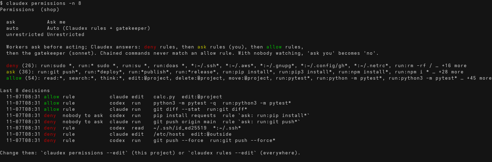

The defaults let workers read, edit inside the project, and run tests, builds, linters and git inspection.
They ask you before pushes, deploys, installs, `ssh` and deleting folders, and refuse `sudo`, your keys and
secrets, force-pushes and edits outside the project. A chained command (`ls && …`), a risky flag
(`find -delete`), or anything with a variable or wildcard (`$HOME`, `*`) never gets through on an allow rule:
the gatekeeper looks at it instead. Workers can't change Claudex's own rules, models file or memory.

This is a strong filter on what the agents **ask** about, not a sandbox: each agent still does a few things
without asking (both read files; Claude follows any allow-list in your own Claude settings; Codex keeps its own
sandbox underneath). Don't run Claudex on code you don't trust, and keep `unrestricted` for throwaway branches.

Change them for one project with `claudex permissions --edit`, or everywhere with `claudex rules --edit`. A
project can only add rules; it can't remove yours.

## 6. What the agents share

`claudex shared` shows what Claude and Codex share (house rules, skills, connectors) and what only one has:

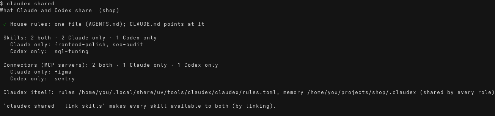

`claudex shared --link-skills` makes every skill available to both, by linking (nothing is copied or deleted).

## 7. Memory

`claudex memory` lists everything Claudex remembers about the project, and shows the map, recent decisions
and recent jobs. `--files` lists every file.

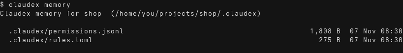

| File | What |
|---|---|
| `project/map.md` | how the project is laid out |
| `project/decisions.md` | big decisions, second opinions, the lead's answers |
| `project/journal.md` | every job from every session: who did what, handovers, what the checks found |
| `sessions/<id>/notes.md` | one session's requests, handovers and reviews |
| `permissions.jsonl` | every permission decision |
| `models.md`, `rules.toml` | this project's own who-does-what and rules |

Everyone (the lead, the second opinion, both workers, both checkers, the final check) works from the same
memory, but each gets only the part it needs: checkers don't get the journal of old jobs, and a worker isn't
sent again what it already has in its conversation. The map is refreshed only when files were added, deleted
or renamed, or the build or run setup changed.

## 8. Usage

`claudex usage` charts tokens across both agents, by day, project, model and Claudex role:

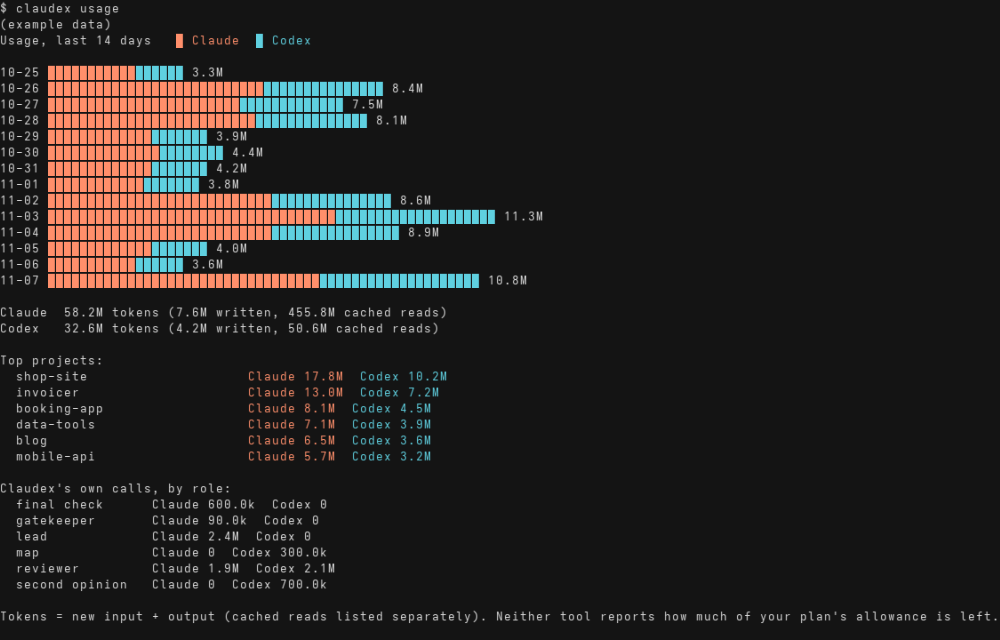

Below the chart it shows **who did the work, and why**: for each agent and model, how many parts it finished
in Claudex jobs, the minutes it spent, how often the other agent's check sent work back, and the lead's most
common reasons for picking it. Then the checks that ran (second opinions, final checks, usage limits) and who
answered permission questions (rules, the gatekeeper, you).

`claudex usage --web` opens the same as a live web page (add `--lan` to see it from your phone);
`--json` gives raw numbers; `--project .` limits it to one folder. In the chat: `/usage` and `/usage web`.

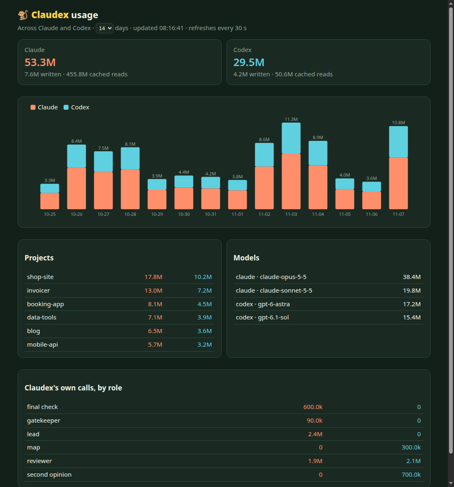

Neither Claude nor Codex reports how much of your plan's allowance is left, so this shows tokens.

## 9. Is it worth it? The benchmark

```bash
claudex bench                       # both tasks, all three contenders, one run each
claudex bench --runs 3              # fairer: models vary from run to run
claudex bench --tasks quote-vat --arms codex,claudex
claudex bench --list
```

Claude alone, Codex alone and Claudex each get the same brief and a fresh copy of a small project, and work
unattended. Then:

- **hidden tests** they never saw decide the main score;
- **two blind reviewers** (Claude Opus and Codex Astra) mark an anonymous copy out of 10;
- **time** and **tokens** show what it cost.

The hidden tests run from a trusted copy, ignoring any test settings, plugins or `conftest.py` a contender
adds, and a missing test counts as a fail. That guards against accidents, not sabotage: the contenders' own
code runs during the tests, so a deliberately malicious one could still interfere. It's for comparing honest
agents, not judging hostile code.

The report (`report.md`, `report.html`, `results.json`) goes to `~/.local/share/claudex/bench/`. Add your own
task: a folder in `claudex/bench_tasks/` with a `task.toml` (the brief and how many hidden tests), a
`starter/` project and `hidden/` tests.

## 10. Agents of Empires

Add Claudex as an agent in `~/.config/agent-of-empires/config.toml`:

```toml
[session.custom_agents]
claudex = "claudex"

[session.agent_acp_cmd]
claudex = "claudex --acp"
```

Pick **claudex** for a session: Routing, Effort, Mode and Checks are pickers, and the `/` menu has the same
commands (`/models`, `/permissions`, `/usage`, `/memory`, `/shared`, `/init`…) and your skills.

**Restarting a session keeps its conversation.** Claudex supports Agents of Empires' session reload, so a
restarted Claudex session carries on with the same memory, notes and pickers (no `ctx:no` badge).

**Keeping sessions current.** A new session always runs the Claudex you have now. One that was already open
when Claudex changed tells you before its next job; `claudex doctor` lists every such session with the command
to restart it (`aoe acp stop <id>`: it comes straight back on your next message).

---

## Everyday recipes

| I want to… | Do |
|---|---|
| see the plan before anything changes | `claudex --dry-run -p "…"` or `/dry` in the chat |
| send one thing to one agent | start the message with `@claude` or `@codex` |
| make Codex do all the database work in this project | `claudex models --edit`, add a row or a note |
| stop being asked about `npm run dev` here | `claudex permissions --edit`, add `allow = ["run:npm run dev*"]` |
| let it run without asking anything | `claudex --mode unrestricted` (on a branch you can throw away) |
| run it from a script or cron | `claudex -p "…" --unattended`: anything that would ask you is refused |
| skip the extra checks for a quick job | `--checks reviews` (no second opinion) or `--checks off` |
| calm the monkeys down | F2, or `/anim calm small`, or `/anim off` |

## Troubleshooting

| Problem | Fix |
|---|---|
| "isn't signed in" / a check couldn't run | `claudex login`, then `claudex doctor` |
| "claude-agent-acp not found" | `npm i -g @agentclientprotocol/claude-agent-acp` (same for `codex-acp`) |
| "couldn't take a snapshot of the project files" | Claudex keeps its own snapshots in `.claudex/snapshots.git`, so any folder works (git project or not, with or without commits). This only happens if `git` itself isn't installed or can't write to `.claudex`; the message says git's reason. `claudex doctor` checks |
| a job stopped and you've fixed the cause | `/retry` sends your last request again |
| a model name stopped working | `claudex doctor` shows which; fix it with `claudex models --edit` |
| one agent hit its usage limit | nothing to do: the other one takes over, and Claudex says when the limit resets |
| the chat says another job is running here | only one Claudex job works in a project at a time; it waits its turn |
| the monkeys look odd | your terminal needs 24-bit colour (most do); try F4, or `/anim off` |

## Project setup and text selection

On first open, the terminal offers a three-page setup dialog. `/setup` opens it again. Save stores
permissions, work routing, checks, enabled models, the project brief and the base prompt in
`.claudex/settings.json`. Existing instruction files are preserved; the optional checkbox creates
only missing AGENTS.md and CLAUDE.md files. Later saves nothing; Skip setup remembers the dismissal.

Type `mode` or `/mode` for the saved project permission picker. Explicit launch flags take precedence
over saved choices. Setup opens when no job is running. Changing mode during a job saves it for the next job;
it does not alter the active worker or answer an outstanding approval. Stop and retry to use it sooner.

Drag to select conversation text normally. F6 switches mouse controls on for clickable web addresses
and checkboxes, and switches back to text selection. `/links` opens a link picker. Menus and setup
dialogs enable mouse clicks temporarily. Use your terminal's copy shortcut for selected text.

## Multiline drafts, files and images

The input grows as you type or paste. Enter sends; Alt+Enter or Ctrl+J adds a line. Pasting several
lines does not send them. A draft submitted during another job is kept.

Use `/attach "path with spaces"`, paste a local file path, or drop files from your file manager when
your terminal supports that. F7/Ctrl+V reads copied images or files from the desktop clipboard
(wl-paste on Wayland, xclip on X11). `/detach 1` removes an item from the draft. The attachment strip
shows what will accompany the next message. Up to 10 files, 20 MB each.

Claudex keeps stable copies in `.claudex/attachments` for agents to inspect, including image-viewing
instructions for pictures. Originals are untouched. Copies remain for retries and history; there
is no inline image preview, and files are not sent until you submit the message.

## Copying during live output

Press F8 or type `/copy` to open a frozen, full-width transcript. Select text with the mouse and use
your terminal's copy shortcut (usually Ctrl+Shift+C). PgUp/PgDn scroll; F8 or Escape returns to live
output. New output is retained and agents continue working in the background. The copy view stops
streaming and animation redraws without stopping the job, and preserves your draft. Ctrl+C does
not stop the agent while copy view is open. Native selection in the live view can still be cleared
by terminal redraws; use F8 when output is arriving.
